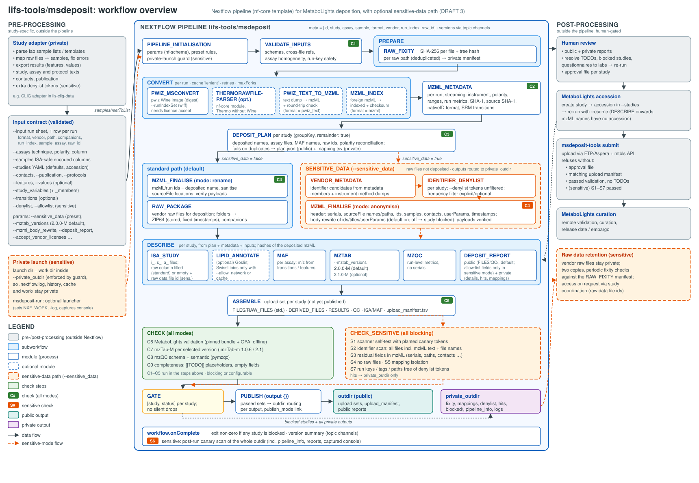

# lifs-tools/msdeposit

[](https://github.com/lifs-tools/msdeposit/actions/workflows/nf-test.yml)
[](https://github.com/lifs-tools/msdeposit/actions/workflows/linting.yml)
[](https://www.nf-test.com)

[](https://www.nextflow.io/)
[](https://github.com/nf-core/tools/releases/tag/4.1.0)
[](https://www.docker.com/)

## Introduction

**lifs-tools/msdeposit** prepares mass spectrometry studies for deposition in [MetaboLights](https://www.ebi.ac.uk/metabolights/). It takes vendor raw data (or mzML) plus tabular study metadata and produces a **checked upload set per study**:

- **ISA-Tab:** investigation, sample and assay files.
- **Data files:** centroided, indexed mzML, plus optionally the vendor raw files.
- **Results:** metabolite assignment files (MAF) and mzTab-M 2.0.0 and/or 2.1.0.
- **Quality control:** run-level metrics as mzQC.
- **Report:** a deposit report.

The pipeline has an optional **sensitive-data mode** for ring trials and multi-site studies, where raw files and file headers can identify the participating laboratories. In this mode:

- only anonymised mzML is deposited, and the raw files stay with the study coordination;
- identifying information is removed from the mzML headers and, where necessary, from spectrum and chromatogram identifiers;
- every file of the upload set is scanned for identifiers before anything is published;
- logs, mappings and check details are kept in a separate private output directory.



### Steps

1. **Validate the inputs (C1):**
   - the run sheet, assays, samples and the studies YAML;
   - the optional contacts, protocols, reported features and values, study variables and SRM transitions.
2. **Convert to centroided, indexed mzML:**
   - vendor files with [ProteoWizard](https://proteowizard.sourceforge.io/) `msconvert`;
   - Thermo files optionally with [ThermoRawFileParser](https://github.com/compomics/ThermoRawFileParser);
   - pwiz text dumps and mzML from elsewhere are normalised.
3. **Read the mzML metadata (C2):** instrument, polarity, ranges, SRM transitions, run metrics and file integrity.
4. **Plan the deposition per study (C3):**
   - deposited file names (original or neutral);
   - assay and MAF files;
   - assay homogeneity and polarity reconciliation.
5. **Finalise every mzML (C4):**
   - standard mode renames the file and sanitises source locations;
   - sensitive mode anonymises the header and, by default, rewrites identifying identifiers in the body;
   - binary data is always verified to be unchanged.
6. **Describe the study:** ISA-Tab, MAF, mzTab-M (2.0.0-M by default), mzQC, and optional lipid name annotation with [Goslin](https://github.com/lifs-tools/pygoslin).
7. **Assemble the upload set (C5)** and check it:
   - C6: MetaboLights validation;
   - C7: mzTab-M validation;
   - C8: mzQC validation;
   - C9: completeness.
8. **Add the public deposit report** to the upload set.
9. **Sensitive mode only:** identifier scan with a scanner self-test (S1, S2), residual header fields (S3), absence of raw data (S4), mapping isolation (S5) and run-key safety (S7).
10. **Gate:** only studies that pass all blocking checks are published. Blocked studies go to the private output directory, and the run ends with an error.

Submission to MetaboLights is deliberately **not** part of the pipeline. Review the upload set and the reports, then upload with the MetaboLights tools.

## Usage

> [!NOTE]
> If you are new to Nextflow and nf-core, please refer to [this page](https://nf-co.re/docs/get_started/environment_setup/overview) on how to set up Nextflow (≥ 25.10.4). Docker is required (Apptainer support is planned). Test your setup first:
>
> ```bash
> nextflow run lifs-tools/msdeposit -profile test,docker --outdir results
> ```

Describe your study in a few CSV files and one YAML file (all columns are explained in [docs/usage.md](docs/usage.md)):

| Input | Content |
| --- | --- |
| `--input` | **Run sheet**: one row per run, i.e. per resulting mzML. Columns `study`, `run`, `assay`, `sample`, `format` (`vendor_raw`/`mzml`/`pwiz_text`) and `path` |
| `--assays` | One row per assay (one ISA assay file): technique, polarity, chromatography, protocols |
| `--samples` | ISA samples with characteristics, factors and comments |
| `--studies` | Studies YAML: title, description, licence, release date, design descriptors, factors, protocols |
| optional | contacts, publication, protocol texts, reported features and values, study variables, SRM transitions, identifier deny/allow lists |

Standard deposition (raw files and mzML):

```bash
nextflow run lifs-tools/msdeposit -profile docker \
   --input runs.csv --assays assays.csv --samples samples.csv --studies studies.yml \
   --contacts contacts.csv --protocols protocols/ \
   --accept_vendor_licenses \
   --outdir results
```

Sensitive-data deposition (anonymised mzML only). Launch from inside the private directory, so that Nextflow's logs and command history stay private:

```bash
mkdir -p /secure/trial/private/run && cd /secure/trial/private/run
nextflow run lifs-tools/msdeposit -profile docker -w /secure/trial/private/work \
   --sensitive_data --private_outdir /secure/trial/private --outdir /secure/trial/public \
   --input runs.csv --assays assays.csv --samples samples.csv --studies studies.yml \
   --denylist lab_identifiers.txt --accept_vendor_licenses
```

`--accept_vendor_licenses` is needed whenever vendor files are converted with the ProteoWizard image, which bundles the vendor reader libraries. Inputs and outputs may also be S3 or S3-compatible object stores, as described in [docs/usage.md](docs/usage.md#object-stores-s3).

> [!WARNING]
> Please provide pipeline parameters via the CLI or Nextflow `-params-file` option. Custom config files including those provided by the `-c` Nextflow option can be used to provide any configuration _**except for parameters**_; see [docs](https://nf-co.re/docs/running/run-pipelines#using-parameter-files).

## Pipeline output

- **`--outdir`:** receives only the upload sets of studies that passed all checks, one folder per study, laid out as MetaboLights expects.
- **`--private_outdir`:** receives everything else: check results and their details, the private deposit report, mappings to the original files, denylists and identifier hits, and the upload sets of blocked studies. In sensitive mode it also receives the Nextflow reports.

The default private location in standard mode is `<outdir>/private`. See [docs/output.md](docs/output.md).

## Documentation

- [docs/usage.md](docs/usage.md): inputs, modes, parameters, object stores, study adapters.
- [docs/output.md](docs/output.md): output layout, checks and reports.
- [docs/design.md](docs/design.md): design, check catalogue and leak boundary.
- [tools/msdeposit-tools](tools/msdeposit-tools/README.md): the Python package and container with the domain logic. [CONTRACTS.md](tools/msdeposit-tools/CONTRACTS.md) describes the files exchanged between steps.

## Credits

lifs-tools/msdeposit was originally written by Nils Hoffmann. It grew out of the MetaboLights deposition of the lipidomics ring trial of the International Lipidomics Society (ILS) Clinical Lipidomics Interest Group (CLIG).

## Contributions and Support

If you would like to contribute to this pipeline, please see the [contributing guidelines](docs/CONTRIBUTING.md).

## Citations

An extensive list of references for the tools used by the pipeline can be found in the [`CITATIONS.md`](CITATIONS.md) file.

This pipeline uses code and infrastructure developed and maintained by the [nf-core](https://nf-co.re) community, reused here under the [MIT license](https://github.com/nf-core/tools/blob/main/LICENSE).

> **The nf-core framework for community-curated bioinformatics pipelines.**
>
> Philip Ewels, Alexander Peltzer, Sven Fillinger, Harshil Patel, Johannes Alneberg, Andreas Wilm, Maxime Ulysse Garcia, Paolo Di Tommaso & Sven Nahnsen.
>
> _Nat Biotechnol._ 2020 Feb 13. doi: [10.1038/s41587-020-0439-x](https://dx.doi.org/10.1038/s41587-020-0439-x).
