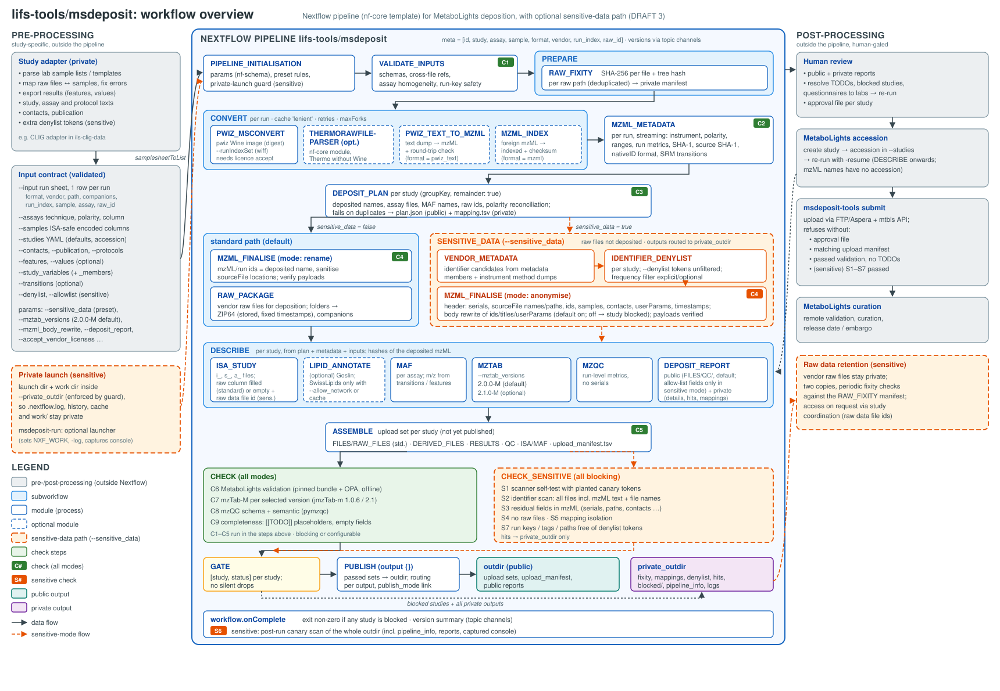

# lifs-tools/msdeposit: Design

Status: **DRAFT 3 (review decisions recorded, §15)** · 2026-10-15 · Author: Nils Hoffmann (with Claude) · Derived from the CLIG ring-trial deposition scripts (`ils-clig-data/scripts/mtbls`). §14 lists the review findings and how they were resolved.

## 1. Purpose and scope

`msdeposit` prepares **mass spectrometry studies for deposition in MetaboLights**. It turns vendor raw data plus tabular study metadata into a **checked upload set**: raw files and/or mzML, ISA-Tab, MAF, mzTab-M and mzQC.

| Mode | Deposited | Use case |
|---|---|---|
| **standard** (default) | vendor raw (directory formats zipped) + mzML + metadata | ordinary studies |
| **sensitive** (preset `--sensitive_data`) | **anonymised mzML only** + metadata; raw files retained privately | ring trials, multi-site studies, raw files with identifying content |

The sensitive handling is **optional**. With the preset off, its steps are skipped and the pipeline behaves like an ordinary deposition. Every check that is not sensitive-specific runs in both modes (§8).

**In scope:**
- input validation
- raw fixity
- conversion
- mzML metadata
- the deposit plan
- mzML finalisation/anonymisation
- ISA-Tab, MAF, mzTab-M, mzQC
- assembly
- checks
- publishing
- reports

**Out of scope:**
- **Study-specific parsing of lab sample lists.** Done by a *study adapter*.
- **Remote submission.** A separate gated CLI, §11.
- **Quantification.** Results are an input.

## 2. Lessons from the CLIG implementation

| Lesson | Consequence |
|---|---|
| ~40% of the effort was study-specific (renumbering, colour-coded templates, template errors) | A strict input contract; the pipeline never parses lab templates |
| Raw files leak names, accounts, paths, serials, codes and time zones; mzML inherits part of it | A sensitive path with anonymisation, layered identifier checks and a leak boundary that also covers Nextflow's own artefacts |
| Validators disagree with templates; jmzTab-m 1.0.6 aborts silently with >1 `opt_` column; mzQC `description` clashes with CV definitions | Pinned validators run on the *assembled* upload set; workarounds live in the writers |
| Conversion is heterogeneous and slow (Agilent IMS ~3 h/file; timsTOF mzML 5× raw) | Per-file processes, `cache 'lenient'`, retries, `maxForks`, per-vendor `ext.args` |
| Long runs died with the session; MinIO re-syncs change mtimes | Launcher wrapper, `-resume` with lenient caching |
| One per-study run manifest (`assays.json`) was the hidden central interface of the old code | An explicit **DEPOSIT_PLAN** artefact (§6) |

## 3. Architecture



*Figure 1: Pre-processing, Nextflow pipeline (standard and sensitive paths, check steps C1–C9 / S1–S7) and post-processing.*

```
 study adapter (private)        lifs-tools/msdeposit
 ──────────────────────        ───────────────────────────────────────────────────────────────────────────────────
 lab lists, templates ──► input ─► VALIDATE_INPUTS ─► RAW_FIXITY ─► CONVERT ─► MZML_METADATA ─► DEPOSIT_PLAN (per study)
 file↔sample mapping      contract                                    (pwiz)    (+transitions)        │
 results export                                                                                       ▼
                                                     MZML_FINALISE (standard: ids/names │ sensitive: anonymise)
                                                                                       ▼
                                                     DESCRIBE: ISA · MAF · mzTab-M (versions param) · mzQC
                                                                                       ▼
                                                     ASSEMBLE upload set (unpublished, per study)
                                                                                       ▼
                                                     CHECK (all modes)  +  CHECK_SENSITIVE (sensitive preset)
                                                                                       ▼
                                                     GATE (status per study) ─► PUBLISH ─► REPORT (public │ private)
                                                                                       ▼
                                                     post-run CANARY_SCAN of whole outdir (sensitive)
                                    human gate ─► msdeposit-tools submit (separate CLI)
```

**Components:**
1. **`msdeposit-tools`**: a Python package and container with one CLI subcommand per step. All domain logic lives here and is unit-tested.
2. **`lifs-tools/msdeposit`**: the nf-core-template pipeline, orchestration only.
3. **Study adapters**: outside the repo; the CLIG adapter stays private. The repo docs specify the contract and ship a minimal example adapter.

## 4. Input contract

Simple flat sheets are validated with nf-schema `samplesheetToList`. Nested files (YAML) and cross-file rules are checked by `VALIDATE_INPUTS` (`msdeposit-tools validate-inputs`, jsonschema plus cross-checks), which fails fast.

### 4.1 `--input` run sheet (CSV, **one row per run**, i.e. per resulting mzML)

| Column | Req. | Description |
|---|---|---|
| `study` | yes | study key |
| `run` | yes | run key, unique per study. **In sensitive mode it must be non-identifying**: it is used in tags and logs (a check enforces this against the denylist) |
| `assay` | yes | assay key (defined in `--assays`) |
| `sample` | yes | ISA Sample Name (defined in `--samples`) |
| `format` | yes | `vendor_raw` / `mzml` / `pwiz_text` |
| `path` | yes | vendor file or directory, mzML, or pwiz text dump |
| `vendor` | no* | original instrument vendor: `thermo`/`sciex`/`agilent`/`bruker_tdf`/`bruker_baf`/`waters`/`shimadzu`; auto-detected for `vendor_raw`; *required for `mzml`/`pwiz_text` |
| `companions` | no | additional files staged together (e.g. `.wiff.scan`); auto-globbed `<stem>.<ext>*` for SCIEX |
| `run_index` | no | 1-based sample index inside a multi-sample file (SCIEX wiff), converted with `--runIndexSet` |
| `polarity` | no | expected polarity; checked against the mzML |
| `deposited_name` | no | override of the deposited file stem |
| `raw_id` | no | public raw-file identifier (sensitive mode); default `<study>_RAW_<nnn>` by raw path |

Several rows may share one raw `path` (multi-sample files). Fixity, packaging and metadata harvesting are deduplicated by path.

### 4.2 `--assays` (CSV)
`study`, `assay`, `technique` (`LC-MS`/`DI-MS`/`FIA-MS`/`GC-MS`/…), `polarity`, `acquisition`, `column_model`, `column_type`, `injection_system`, `measurement_type`, `instrument_fallback`, `protocol_keys`. One assay maps to one ISA assay file. **Homogeneity check:** all runs of an assay must share polarity, vendor and instrument model.

### 4.3 `--samples` (CSV, ISA-safe encoding)
Columns: `study`, `source_name`, `sample_name`, then `characteristics:<Name>`, `characteristics:<Name>::source`, `characteristics:<Name>::accession`, `factor:<Name>` (+ `::source`/`::accession`), `comment:<Name>`. The tools package maps them to ISA headers and checks them against the MetaboLights sample template. No duplicate headers.

### 4.4 `--studies` (YAML)
- A `defaults` block, deep-merged into each study.
- Per study:
  - `accession` (optional; `s_`/`a_`/`m_` names use it once known)
  - title, description
  - design descriptors, factors
  - protocol text keys
  - license, release date
  - related studies

### 4.5 Optional inputs

| Param | Content |
|---|---|
| `--contacts`, `--publication` | people (all or per study), publication YAML |
| `--protocols` | text blocks `<key>.md` and `<study>/<key>.md`; unresolved keys → `[[TODO-…]]` |
| `--features` | one row per reported feature and assay: `study`, `assay`, `feature`, `name`, `level`, `formula`, `mz`, `rt`, `adduct`, `charge`, `database_id`, `quantifier` |
| `--values` | `study`, `feature`, and either `run` (per-run value) or `study_variable` (aggregate), `value`, `unit` (UO term), `variation`, `variation_type` (`sd`/`cv_percent`/`none`). JSON-Schema `if/then` enforces exactly one of `run`/`study_variable` |
| `--study_variables` | `study`, `study_variable`, `description`, `average_function` |
| `--study_variable_members` | `study`, `study_variable`, `sample` (long format) |
| `--transitions` | SRM transitions per study/assay if the mzML has no named transitions |
| `--denylist`, `--allowlist` | extra identifier tokens (bypass all filters); allowed tokens or regions (default: shared contact/author rows) |

## 5. Parameters

**Mode presets and switches.** `--sensitive_data` is a **preset**. It sets the switches below and **rejects** contradicting overrides, rather than forcing them silently.

| Switch | Standard default | Sensitive preset |
|---|---|---|
| `deposit_raw` | true | false (required) |
| `finalise_mode` | `rename` (ids/names only) | `anonymise` (required) |
| `deposited_naming` | `original` (sanitised stem) | `neutral` (required: `<sample>_<POL>[_<acq>]`) |
| `identifier_scan` | false | true (required) |
| `scan_mzml` | – | true (required) |
| `canary_scan` | false | true (required) |
| `fail_on_identifier_hits` | – | true (required) |
| `mzml_body_rewrite` | – | **true** (default). When false, identifying text in spectrum/chromatogram ids, titles or userParams is not rewritten, and the affected studies are **blocked** by S2 |
| `enforce_private_launch` | – | **true** (default): refuse to start unless the launch directory and the work directory are inside `private_outdir` (§9) |
| `deposit_report` | true (uploaded as `FILES/QC/deposit_report.html`) | true, generated in **public-safe form** (§9) |
| `timestamp_policy` | `keep` | `keep` / `date` / `drop`; also applies to ISA comments and mzQC |
| `private_outdir` | optional | **required**, ≠ `outdir`, neither nested in the other |
| `email`, `hook_url` | allowed | must be unset |

**Other parameters**

| Group | Parameters (defaults) |
|---|---|
| Results | **`mztab_versions`** (`2.0.0-M`; allowed `2.0.0-M`, `2.1.0-M`, or both comma-separated), `maf` (true), `lipid_annotation` (`none`/`goslin`/`goslin+swisslipids`), `swisslipids_cache`, `allow_network` (false) |
| Conversion | `accept_vendor_licenses` (**required** to use the pwiz vendor-reader image), `thermo_converter` (`pwiz`/`thermorawfileparser`). Container and per-vendor args go in `conf/modules.config` (`ext.args`), not params |
| Describe | `mtbls_study_category` (`ms-mhd-enabled`), `controlled_value_profile` (`validator`/`mhd`). The MetaboLights template version is tied to the pinned validation bundle |
| Checks | `fail_on_validation_errors` (false), `fail_on_todo_placeholders` (false; true for submission-ready runs) |
| Outputs | `outdir`, `private_outdir`, `publish_mode` (`link`; same filesystem required for large data) |

## 6. Modules

| Module | Scope | Function |
|---|---|---|
| `VALIDATE_INPUTS` | global | schemas, cross-file references, homogeneity of assays, run-key safety (sensitive) |
| `RAW_FIXITY` | per raw path | SHA-256 per file + tree hash (private) |
| `PWIZ_MSCONVERT` | per run | vendor → mzML (`--runIndexSet` for multi-sample files); Wine image runs as root with outputs chowned, or with a writable prefix on Apptainer; `cache 'lenient'`, retry by exit code |
| `THERMORAWFILEPARSER` | per run (opt-in) | nf-core module for Thermo without Wine |
| `PWIZ_TEXT_TO_MZML` | per run | text dump → mzML + round-trip check |
| `MZML_INDEX` | per run (`format=mzml`) | normalise foreign mzML to indexed mzML with checksum |
| `MZML_METADATA` | per run | JSON: instrument, components, polarity, ranges, metrics, SHA-1, source SHA-1, nativeID format, **SRM transitions** |
| `DEPOSIT_PLAN` | per study | **central interface**: assay files, deposited names, MAF names, raw ids, polarity reconciliation; fails on duplicates or inhomogeneous assays → `plan.json` (public) + `mapping.tsv` (private) |
| `MZML_FINALISE` | per run | `rename`: set `mzML/@id`, `run/@id`, sanitise `sourceFile` locations; `anonymise`: header rewrite (serials, sourceFile names/locations, ids, samples, `fileDescription/contact`, free-text `userParam`s, timestamp policy) + **body rewrite** (on by default via `mzml_body_rewrite`; denylist tokens in chromatogram/spectrum ids, titles and userParams are replaced by neutral placeholders and the index is rebuilt). Always: verification, i.e. the binary payloads must be unchanged (hash over all `<binary>` contents), element counts equal, index valid, independent re-read |
| `RAW_PACKAGE` | per raw path (standard) | directory formats → ZIP64 `ZIP_STORED` with fixed timestamps; sanitised names; companions kept together |
| `VENDOR_METADATA` | per raw path (sensitive) | identifier candidates **from metadata members only** (Thermo header/method, Bruker `GlobalMetadata`, Waters `_HEADER.TXT`/`_extern.inf`/`_inlet.inf`, Agilent `AcqData/*.xml`, SCIEX header) + instrument-method dump for protocol drafting (private) |
| `IDENTIFIER_DENYLIST` | per study (sensitive) | candidates + `--denylist` (unfiltered) + run/assay names → denylist; the frequency filter is explicit and optional |
| `ISA_STUDY`, `MAF`, `MZTAB`, `MZQC` | per study | writers from the plan + metadata + inputs; mzTab-M writes one file per selected version |
| `LIPID_ANNOTATE` | per study (optional) | Goslin (+ SwissLipids only with `allow_network`/cache) |
| `ASSEMBLE` | per study | upload set in the work dir (not published): `FILES/RAW_FILES`, `FILES/DERIVED_FILES`, `RESULTS`, `QC`, ISA, `upload_manifest.tsv` |
| Checks | per file / per study | see §8 |
| `GATE` | per study | combines check statuses → `[study, status]`; never silently drops a study |
| `PUBLISH` | per study | publishes only passed upload sets to `outdir`; blocked studies → `private_outdir/blocked/` |
| `DEPOSIT_REPORT` | per study + global | **public** report per study (deposited by default as `FILES/QC/deposit_report.html`; content rules in §9) + **private** report (details, hits, mappings, original names) |

## 7. Workflow definition (sketch, Nextflow 25.10 strict syntax)

```groovy
workflow MSDEPOSIT {
    take: ch_runs  // [meta, path, companions] from samplesheetToList; meta = [id, study, assay, sample, format, vendor, run_index, raw_id]
    main:
    VALIDATE_INPUTS(...)                                   // fails fast
    RAW_FIXITY(ch_runs.map { m, p, c -> [m.subMap('study','raw_id'), p] }.unique())
    ch_conv  = CONVERT(ch_runs)                            // pwiz | thermorawfileparser | text→mzML | MZML_INDEX
    MZML_METADATA(ch_conv.mzml)

    ch_study_meta = MZML_METADATA.out.json
        .map { m, j -> [groupKey(m.study, n_runs[m.study]), m, j] }
        .groupTuple(remainder: true)                       // incomplete groups reported, not dropped
    DEPOSIT_PLAN(ch_study_meta)

    ch_plan_per_run = DEPOSIT_PLAN.out.plan.flatMap { s, plan -> runsOf(plan) }   // [run_id, planned names]
    MZML_FINALISE(ch_conv.mzml.join(ch_plan_per_run, by: 0, failOnMismatch: true),
                  params.finalise_mode)                    // rename | anonymise

    ch_raw_pkg = params.deposit_raw ? RAW_PACKAGE(ch_raw_unique).zip : channel.empty()
    DESCRIBE(DEPOSIT_PLAN.out.plan, MZML_METADATA.out.json, MZML_FINALISE.out.hashes, inputs)  // ISA, MAF, MZTAB(versions), MZQC
    ASSEMBLE(DESCRIBE.out.files, MZML_FINALISE.out.mzml, ch_raw_pkg)

    CHECK(ASSEMBLE.out.upload_set)                          // validators, integrity, completeness: all modes
    ch_sensitive_status = params.sensitive_data
        ? CHECK_SENSITIVE(ASSEMBLE.out.upload_set, VENDOR_METADATA_AND_DENYLIST(ch_raw_unique)).status
        : channel.empty()
    GATE(CHECK.out.status.mix(ch_sensitive_status).groupTuple())   // [study, status]
    PUBLISH(ASSEMBLE.out.upload_set.join(GATE.out.passed))
    DEPOSIT_REPORT(...)

    emit: ...
}
// workflow.onComplete: exit non-zero if any study is blocked; in sensitive mode run CANARY_SCAN over outdir
```

- Versions are captured through **topic channels** (`topic: versions`). The pwiz version is read from the image label or mzML `<software>`, not from `wine msconvert`.
- Publishing uses the workflow **`output {}` block**, so the public/private routing is defined per output in one place.

## 8. Check steps

All checks emit `[study, check, status, details_private, counts_public]` and feed the GATE. Where a check is "blocking", blocked studies are reported, published to `private_outdir/blocked/`, and make the run exit non-zero.

### 8.1 Checks in both modes (`CHECK`)

| ID | Check | Where | Blocking |
|---|---|---|---|
| C1 | Input schemas, cross-file references, unique keys, assay homogeneity declared | VALIDATE_INPUTS | yes (fail fast) |
| C2 | Conversion result: mzML readable, indexed, spectra or chromatograms > 0, expected polarity | MZML_METADATA | yes per run |
| C3 | Plan: unique deposited names, every run planned, homogeneous assays, no orphan samples | DEPOSIT_PLAN | yes |
| C4 | Finalisation integrity: body hash or element counts equal, index offsets valid, re-read by an independent parser | MZML_FINALISE | yes |
| C5 | Upload manifest: every referenced file present, no unreferenced files, SHA-256 recorded, MetaboLights file-name rules (`.-_A-Za-z0-9`), no zero-byte files | ASSEMBLE | yes |
| C6 | MetaboLights validation on the **assembled** set (pinned bundle + OPA, offline) | CHECK | configurable (`fail_on_validation_errors`) |
| C7 | mzTab-M validation for each selected version (2.0: jmzTab-m 1.0.6 structure + semantic; 2.1: dev validator) | CHECK | configurable |
| C8 | mzQC schema + semantic (pymzqc) | CHECK | configurable |
| C9 | Completeness: remaining `[[TODO-…]]` placeholders, empty required ISA fields, missing MAF m/z/RT; listed per study | CHECK | configurable (`fail_on_todo_placeholders`) |

### 8.2 Sensitive-path checks (`CHECK_SENSITIVE`; all blocking)

| ID | Check |
|---|---|
| S1 | **Scanner self-test:** before scanning, plant synthetic canary tokens in a temporary copy of one file per file type (header field, chromatogram id, userParam, ISA cell, file name) and require that every one is found |
| S2 | **Identifier scan of every file in the upload set:** all mzML (all text outside binary payloads, streaming), ISA, MAF, mzTab-M, mzQC and **file names**. Denylist tokens include short codes and initials (case-sensitive) and transliteration variants (ü/ue). Hits go to private only |
| S3 | **Residual-field check of the anonymised mzML:** no `MS:1000529` serial number, no `sourceFile/@location` paths, no `fileDescription/contact`, no free-text `userParam`s in the header, timestamps match the policy, `mzML/@id` = deposited stem |
| S4 | **Raw absence:** no vendor raw files or extensions (`.raw`, `.d`, `.wiff`, `.lcd`, …) or zips of them in the upload set; `Raw Spectral Data File` column empty and `Comment[Raw data file identifier]` present |
| S5 | **Mapping isolation:** `mapping.tsv`, denylist, hits and vendor metadata exist only under `private_outdir`; nothing from `private_outdir` is referenced by the upload set |
| S6 | **Post-run canary scan (`workflow.onComplete`):** scan everything under `outdir`, including `pipeline_info` and reports, and the console summary for denylist tokens; any hit fails the run and quarantines the affected outputs |
| S7 | **Run-key safety:** run and assay keys, tags and published paths contain no denylist token (they appear in Nextflow logs and traces) |

## 9. Sensitive data: the leak boundary

1. **Nextflow artefacts.**
   - The `sensitive` profile (set by the preset) sends `params_*.json`, the execution report, timeline, trace and DAG to `private_outdir/pipeline_info`.
   - Notifications are disabled and process tags use `meta.raw_id`.
   - **Launch-location guard** (`enforce_private_launch`, on in sensitive mode):
     - Nextflow writes `.nextflow.log`, `.nextflow/` (history with full command lines, cache) and by default `work/` into the launch directory. Pipeline configuration cannot relocate them.
     - At startup the pipeline therefore checks that `workflow.launchDir` and `workflow.workDir` lie inside `private_outdir`, and refuses to start otherwise, with a message saying how to launch correctly.
   - **`msdeposit-run`** is an *optional* convenience launcher, not required. It creates the private launch directory, sets `NXF_WORK` and `-log` there, starts Nextflow, and tees the console output into the private root.
2. **Error output.** Failed tasks print commands and stderr to the console (msconvert echoes source paths). The console is the user's own terminal and is not persisted unless captured. `msdeposit-run` captures it privately, and `CANARY_SCAN` (S6) scans the captured log when present.
3. **Containers.** Only the needed paths are mounted; no network unless `allow_network`.
4. **What the anonymised mzML keeps:** instrument model, software versions, the vendor file SHA-1 (provenance) and timestamps per policy.
5. **When body text is identifying** (e.g. SRM chromatogram ids from lab method names): the body rewrite (default on) replaces the affected tokens. With `--mzml_body_rewrite false`, S2 blocks the study, and the private report names the fields.
6. **Public deposit report in sensitive mode.**
   - **Built from an allow-list of fields only:** check IDs and statuses, counts (runs, files, sizes, hits as numbers), tool and validator versions, parameter *names* with non-path values, and placeholder counts.
   - **Never included:** paths, original or raw file names, run keys (deposited names and `raw_id`s only), denylist tokens, hit contexts, sample-sheet free text, error messages or stderr.
   - **Scanned like every other file:** the report is generated before S2, and S2 and S6 scan it. A hit blocks the study.

## 10. Containers, licences, platforms
- **pwiz vendor-reader image:**
  - Pulled by digest, never mirrored by lifs-tools.
  - Its use requires `--accept_vendor_licenses`.
  - The docs give a fallback if a digest disappears (rebuild from the pwiz Dockerfile, or `thermorawfileparser` for Thermo).
- **Docker:** the Wine prefix is root-owned, so the module overrides the template's `-u $(id -u):$(id -g)` and chowns its outputs.
- **Apptainer:** **not supported in 1.0** (decision 2026-10-15; Docker only). Planned for a later release: needs `--writable-tmpfs` or a copied `WINEPREFIX` in `$TMPDIR`, and must be tested on the Wine image first. The `msdeposit-tools` image itself has no such constraint.
- **`msdeposit-tools` image:** one image for the local modules. It bundles the MetaboLights validation bundle, OPA, jmzTab-m 1.0.6 and the 2.1 validator, so it works offline.
- **MultiQC:** not used, because it would publish sample names. `DEPOSIT_REPORT` replaces it.

## 11. Submission and accession (outside the pipeline)

`msdeposit-tools submit --upload-set <outdir>/<study> --study-id MTBLSxxxx --approval <file>`. It refuses to run if any of these holds:
- no approval file;
- a manifest checksum mismatch;
- validation errors;
- remaining TODO placeholders;
- for sensitive sets, no passed S1–S7.

**Accession handling:** the preferred route is to set `accession` in `--studies` and re-run (`-resume` reuses conversion and finalisation; only DESCRIBE onwards is recomputed). mzML names never contain the accession, so re-runs do not touch the large files.

## 12. Large data and HPC
- **Same filesystem:** `publish_mode: 'link'`; `outdir`, `private_outdir` and work must share one filesystem.
- **Caching:** `cache 'lenient'` and an optional private `storeDir` for converted mzML. Re-syncing the raw mirror then does not trigger reconversion.
- **Throughput and retries:** `maxForks` on conversion (replaces the old container cap); Wine failures are retried by exit code with escalating time limits (Agilent IMS ~3 h/file).
- **Profiles:** institutional/HPC profiles via `custom_config_base`, with an offline option.
- **Cheap metadata edits:** changing sample metadata recomputes DESCRIBE onwards only; deposited names change only if the plan changes.

## 13. Testing
- **pytest** for every subcommand, including:
  - planted-token tests for each field and file type (S1/S2);
  - false-positive tests;
  - anonymisation residual-field tests (S3).
- **nf-test** profiles:
  - `test`: standard mode, small mzML + the nf-core test-datasets Thermo raw via ThermoRawFileParser; CI on every PR;
  - `test_sensitive`: synthetic files with planted identifiers; the pipeline must block, then pass after the denylist is fixed; CI;
  - `test_pwiz`: Wine conversion of licence-cleared vendor files; nightly, on a self-hosted runner;
  - `test_full`: a public MetaboLights study.
- **mzTab-M versions:** CI runs `--mztab_versions 2.0.0-M` (default) and `2.0.0-M,2.1.0-M`.
- **CLIG regression (private, in `ils-clig-data`):**
  - feeds the existing converted mzML as `format=mzml` rows, with the vendor and the adapter's deposited names and raw ids;
  - mzML compared by body hash and header diff, the other files by content after normalising dates;
  - no 0.9 TB reconversion.

## 14. Review findings and resolutions (review of DRAFT 1, 2026-10-15)

| # | Sev. | Finding (short) | Resolution in DRAFT 2 |
|---|---|---|---|
| 1 | blocker | No deposit-plan artefact; naming needs metadata before anonymisation | `DEPOSIT_PLAN` per study (§6, §7) |
| 15 | blocker | Identifier scan did not see the mzML; validation ran without the files | ASSEMBLE → CHECK/CHECK_SENSITIVE on the assembled set (§7, §8) |
| 19 | blocker | Leaks through Nextflow artefacts (log, history, reports, console, notifications) | `sensitive` profile, launcher, pseudonymous tags, S6 canary scan (§8.2, §9) |
| 2, 3 | major | Multi-sample wiff and sidecar staging | one row per run, `run_index` + `--runIndexSet`, `companions` (§4.1) |
| 4 | major | Global denylist is a barrier; frequency heuristic fails for single studies | per-study denylist, explicit filters, unfiltered user tokens (§6) |
| 5 | major | Pre-converted mzML path underspecified | `format`/`vendor` split, `MZML_INDEX`, nativeID from the mzML (§4.1, §6) |
| 8 | major | ISA headers as CSV columns are not schema-safe | prefixed, suffix-encoded columns (§4.3) |
| 9 | major | Assay attributes at study level | `--assays` table, homogeneity check (§4.2) |
| 10 | major | Results contract ambiguous and lipid-centric | `--features` + `--values` (+ membership) with defined vocabularies (§4.5) |
| 13 | major | A single switch hides unsafe combinations | preset + explicit switches, validated rejections (§5) |
| 16 | major | No join keys; groupKey drops studies silently; gate drops silently | explicit joins, `remainder: true`, status-based GATE, non-zero exit (§7, §8) |
| 17 | major | `renameForDeposit` in `map` does not rename | always-run `MZML_FINALISE` with `rename`/`anonymise` (§6) |
| 20 | major | One-root-per-module contradicts mixed outputs | routing per output via `output {}`; public/private reports (§6, §7) |
| 21 | major | Header-only anonymisation too narrow; code lacks userParam/contact/timestamp handling and re-read | extended header scope, optional body rewrite, independent re-read, S3 (§6, §8.2) |
| 22 | major | Scanner bugs (manual tokens filtered; `<binary>` lines skipped) and fragile heuristics | unfiltered user tokens, streaming tokeniser, short codes, transliteration, S1 self-test (§8.2). The live bugs in the CLIG scripts are fixed separately |
| 23 | major | Wine image vs uid mapping/Apptainer; licence mirroring | §10 |
| 25 | major | CI cannot run Wine; regression scope | test profiles and private regression (§13) |
| 26 | major | Accession-dependent file names | `accession` in `--studies`; re-run from DESCRIBE (§11) |
| 27 | major | Large files: links, lenient cache, deterministic zips | §6 RAW_PACKAGE, §12 |
| 6, 7, 11, 12, 14, 18, 24, 28, 29 | minor | VENDOR_METADATA merge, transitions in metadata JSON, YAML merge semantics, run-key safety, `ext.args`, strict syntax and topic versions, offline validation assets, `maxForks`/retries, submit refusals | addressed in §4–§12 |
| user | — | Check steps, especially on the sensitive path | §8 (C1–C9, S1–S7) |
| user | — | mzTab-M 2.0.0/2.1.0 as options, 2.0.0 default | `mztab_versions` (§5, §13) |

## 15. Decisions on the open questions (2026-10-15)

| # | Question | Decision |
|---|---|---|
| 1 | mzML body rewrite in sensitive mode | **On by default** (`mzml_body_rewrite true`), can be switched off; when off, studies with identifying body text are **blocked** by S2 |
| 2 | Launcher mandatory? | **No.** In sensitive mode the pipeline enforces the important part itself: it refuses to start unless launch and work directories are inside `private_outdir` (`enforce_private_launch`). `msdeposit-run` stays an optional convenience wrapper |
| 3 | Public deposit report in the study | **Yes, by default** (`FILES/QC/deposit_report.html`). In sensitive mode it is built from an allow-list of non-identifying fields and is scanned by S2 and S6 (§9) |
| 4 | Platforms | **Docker only for 1.0.** Apptainer/HPC support for the Wine image in a later release |
