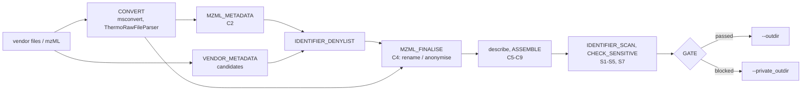

# lifs-tools/msdeposit: Preparing a submission

This page walks through a deposition from vendor files to a checked upload set. It covers converting the files, removing what identifies the lab (sensitive mode), reviewing the identifier hits and checking the result independently before the upload. [usage.md](usage.md) is the reference for every table column and parameter. This page shows the order in which to use them.

Public MetaboLights studies with raw data from three vendor platforms serve as examples:

| Study                                                     | Content                                               | Vendor files                                                              | Size   |
| --------------------------------------------------------- | ----------------------------------------------------- | ------------------------------------------------------------------------- | ------ |
| [MTBLS1381](https://www.ebi.ac.uk/metabolights/MTBLS1381) | targeted (SRM) lipid mediators, platelets             | SCIEX QTRAP 6500, `.wiff` + `.wiff.scan` (180 runs, ~0.4 MB each)         | 0.3 GB |
| [MTBLS1375](https://www.ebi.ac.uk/metabolights/MTBLS1375) | targeted lipidomics, plasma and NIST SRM 1950         | Agilent 6495, `.d` directories zipped as `.d.zip` (157 runs, ~14 MB each) | 2 GB   |
| [MTBLS1382](https://www.ebi.ac.uk/metabolights/MTBLS1382) | DIA (untargeted) lipid mediator validation, platelets | Thermo Q Exactive HF, `.raw` (34 runs, ~50 MB each)                       | 3.4 GB |

These files are public, but their headers still carry what a ring trial has to hide: paths on the acquisition PC, logon accounts, workstation names, instrument serial numbers, sequence and method names, and people's names in data folders. That makes them a realistic rehearsal for your own data.

## How the files are processed



- **Conversion** turns every run into a centroided, indexed mzML.
- **Filtering** (sensitive mode) builds a per-study **denylist** of identifying tokens and finalises every mzML:
  - **Header anonymisation:** serial numbers, contacts, source paths and free-text parameters are removed, and sample and run identifiers are replaced.
  - **Body rewrite:** denylisted tokens in spectrum and chromatogram identifiers, titles and user parameters are replaced by neutral placeholders.

  The finalisation verifies that the binary data is unchanged.

- **Pseudonymisation:** every deposited mzML is named `<sample>_<POL>[_<acquisition>]` after your neutral sample names. The raw files get public identifiers (`<study>_RAW_<nnn>`). The only link back to the original files is `mapping.tsv` in the private output.
- **Scan:** the upload set is scanned for denylist tokens (S2), after a self-test (S1). Only studies that pass every blocking check reach `--outdir`.

## 0. Prerequisites

- **Nextflow and Docker:** Nextflow ≥ 25.10.4 and Docker; your user must be allowed to run containers.
- **The `msdeposit-tools` image:** until it is published, build it once from a checkout of this repository:

  ```bash
  docker build -t ghcr.io/lifs-tools/msdeposit-tools:dev tools/msdeposit-tools
  ```

- **Vendor converter:**
  - **Thermo rows need `vendor` set to `thermo`:** `--thermo_converter thermorawfileparser` only applies to rows with that value. A `.raw` file without a vendor could also be Waters, so it goes to ProteoWizard.
  - **Licences:** vendor files other than Thermo `.raw` are converted with the ProteoWizard image, which bundles the vendor reader libraries. Read the [ProteoWizard licences](https://proteowizard.sourceforge.io/licenses.html) and pass `--accept_vendor_licenses`.
  - **Thermo without Wine:** Thermo `.raw` files can be converted with ThermoRawFileParser instead (`--thermo_converter thermorawfileparser`), which needs neither Wine nor the licence switch.

## 1. Rehearse on MetaboLights data

The `test_mtbls` profile runs the sensitive path on three real runs:

- two SCIEX runs of MTBLS1381, as their public mzML;
- one Thermo `.raw` file of MTBLS1382, converted with ThermoRawFileParser.

```bash
git clone https://github.com/lifs-tools/msdeposit.git && cd msdeposit
tests/data/mtbls/fetch.sh                         # ~53 MB, verified against the MetaboLights checksums
nextflow run . -profile test_mtbls,docker --outdir results/public --private_outdir results/private
```

To include the ProteoWizard conversion of the SCIEX `.wiff` files:

```bash
tests/data/mtbls/fetch.sh --vendor
nextflow run . -profile test_mtbls,docker --outdir results/public --private_outdir results/private \
    --input tests/data/mtbls/runs_vendor.csv --thermo_converter pwiz --accept_vendor_licenses
```

Look at the inputs in [`tests/data/mtbls`](../tests/data/mtbls) and the outputs side by side:

- **Public output:** `results/public/SRM/FILES/DERIVED_FILES/PLT_unst_01_ALT_SRM.mzML` has neither the original file name nor the `D:\…` source location of `data/QTrap007485_031618-Unst1.mzML`.
- **Private output:**
  - `results/private/SRM/denylist.tsv` lists what was removed and where it was found;
  - `results/private/SRM/mapping.tsv` links the deposited file to the original file.

The same profile runs in CI (`tests/mtbls.nf.test`), followed by an independent scan for identifiers known to be in the original files; see [step 7](#7-verify-the-upload-set-independently).

## 2. Collect the files

Put all files of a submission below one directory, next to the run sheet. Relative paths in the run sheet resolve against the run sheet's directory. In sensitive mode the folder names below it are harvested as identifier candidates, while the directories above it are not.

| Vendor              | `path` in the run sheet                                 | Notes                                                                                                                 |
| ------------------- | ------------------------------------------------------- | --------------------------------------------------------------------------------------------------------------------- |
| Thermo              | `run.raw`                                               | single file; `--thermo_converter thermorawfileparser` avoids Wine                                                     |
| SCIEX               | `run.wiff`                                              | `run.wiff.scan` is found automatically. Multi-sample `.wiff`: one row per sample with `run_index`, sharing the `path` |
| Agilent             | `run.d/` (directory)                                    | must contain `AcqData/`. Unzip `.d.zip` archives first                                                                |
| Bruker              | `run.d/` (directory)                                    | `analysis.tdf` (timsTOF) or `analysis.baf`                                                                            |
| Waters              | `run.raw/` (directory)                                  | `_FUNC*.DAT`, `_HEADER.TXT`, …                                                                                        |
| Shimadzu            | `run.lcd`                                               |                                                                                                                       |
| converted elsewhere | `run.mzML` with `format=mzml` and the original `vendor` | re-indexed only; there is no vendor metadata, so the denylist relies on the mzML header and the file names            |

Download the files of a public MetaboLights study, here a few runs of each example study:

```bash
FTP=https://ftp.ebi.ac.uk/pub/databases/metabolights/studies/public
mkdir -p submission/data && cd submission/data
# SCIEX (MTBLS1381): the .wiff and its .wiff.scan
for f in QTrap007485_031618.wiff QTrap007485_031618.wiff.scan; do curl -fO "$FTP/MTBLS1381/FILES/$f"; done
# Thermo (MTBLS1382)
curl -fO "$FTP/MTBLS1382/FILES/QExHF03_HPLC_0000195.raw"
# Agilent (MTBLS1375): .d directories, deposited as .d.zip
curl -fO "$FTP/MTBLS1375/FILES/PBLK_01.d.zip" && unzip -q PBLK_01.d.zip && rm PBLK_01.d.zip   # -> PBLK_01.d/
```

`<study>/HASHES/data_sha256.json` on the same server holds the SHA-256 of every file. For a whole study, mirror `FILES/` with `wget -r -np -nH --cut-dirs=7 "$FTP/MTBLS1382/FILES/"`, or use Aspera or Globus (see the MetaboLights download help).

## 3. Write the input tables

The pipeline reads a fixed set of tables (the _input contract_, [usage.md](usage.md#inputs)): run sheet, assays, samples, studies YAML, and optional contacts, protocols, results and identifier lists. How you get there is study-specific. For more than a handful of runs, write a small **study adapter** script that reads your sequence tables or an existing ISA-Tab and writes the tables ([usage.md](usage.md#study-adapters)).

For a MetaboLights study, the ISA-Tab already holds everything:

| ISA-Tab (`s_*.txt`, `a_*.txt`, `i_Investigation.txt`)                                | msdeposit table                                                                                          |
| ------------------------------------------------------------------------------------ | -------------------------------------------------------------------------------------------------------- |
| `Raw Spectral Data File`                                                             | run sheet `path` (`format=vendor_raw`)                                                                   |
| `Sample Name`                                                                        | run sheet `sample` and samples `sample_name`. **Sensitive mode: choose new, neutral names**              |
| `Source Name`, `Characteristics[…]`, `Factor Value[…]` (+ term source and accession) | samples `source_name`, `characteristics:<Name>`, `factor:<Name>` (+ `::source`, `::accession`, `::unit`) |
| `Parameter Value[Scan polarity]`                                                     | assays `polarity`, run sheet `polarity`                                                                  |
| `Parameter Value[Column model]`, `[Column type]`, `[Chromatography Instrument]`      | assays `column_model`, `column_type`, `injection_system`                                                 |
| Study title, description, design descriptors, factors, protocols, contacts           | studies YAML, `--contacts`, `--protocols`                                                                |

[`tests/data/mtbls`](../tests/data/mtbls) is such a translation for three runs.

**Rules for sensitive mode** (enforced by C1 and S7):

- **Keys:** study, run and assay keys appear in logs, process tags and work directories. Use neutral keys such as `S1`, `r001` and `POS`, never lab codes or original file names.
- **Sample names** become the deposited mzML names. `PLT_unst_01` is fine. `QTrap007485_031618-Unst1` repeats the original file name and is rejected.
- **Free text:** keep the lab out of titles, descriptions, protocols and sample comments. They are deposited and scanned too.

Validate the tables before anything is converted:

```bash
docker run --rm -v "$PWD:$PWD" -w "$PWD" ghcr.io/lifs-tools/msdeposit-tools:dev \
    msdeposit-tools validate-inputs --input runs.csv --assays assays.csv --samples samples.csv \
    --studies studies.yml --mode sensitive --outdir /tmp/validated
```

## 4. Test the conversion on a few runs

Conversion is the slow part (minutes per Thermo or SCIEX file; hours for Agilent ion-mobility files). First run a run sheet with one or two runs per assay and vendor. Standard mode is enough for this. `--deposit_raw false` skips packaging the raw files:

```bash
head -n 3 runs.csv > runs.pilot.csv
nextflow run lifs-tools/msdeposit -profile docker -params-file params.yml \
    --input runs.pilot.csv --deposit_raw false --outdir pilot/public --private_outdir pilot/private
```

Then check:

- **Gate decision:** `pilot/private/<study>/gate.json`, plus `checks/check_C2.<run>.json` for every run. C2 reports spectra, chromatograms, polarity and SRM transitions.
- **Converted mzML:** `pilot/public/<study>/FILES/DERIVED_FILES/*.mzML` should be centroided, with plausible spectrum or chromatogram counts.

Typical findings:

| Finding                                       | Action                                                                                                                                                                               |
| --------------------------------------------- | ------------------------------------------------------------------------------------------------------------------------------------------------------------------------------------ |
| C2/C3 polarity mismatch                       | The run contains both polarities. MTBLS1381 is labelled negative, but its SRM method has a positive experiment. Use `alternating` in the run sheet and the assay, or split the assay |
| No spectra, only chromatograms                | Expected for SRM/MRM data (SCIEX, Agilent QQQ)                                                                                                                                       |
| Missing ion mobility, lock-mass scans present | Adjust the per-vendor `msconvert` options (`ext.args` of `PWIZ_MSCONVERT` in a `-c` config, see [usage.md](usage.md#conversion))                                                     |
| A conversion task fails                       | Check that the companion files (`.wiff.scan`) and complete `.d` directories are present; the task's `.command.err` in the (private) work directory has the converter output          |

`-resume` reuses finished conversions, so the full run later only converts the remaining files.

## 5. Run the pseudonymisation

### Provide what the pipeline cannot know

The pipeline harvests identifier candidates from three sources:

- **Vendor metadata:**
  - Thermo headers and methods;
  - SCIEX `.wiff` headers;
  - Agilent `AcqData` XML;
  - Bruker `GlobalMetadata` and `SampleInfo.xml`;
  - Waters `_HEADER.TXT`.
- **mzML headers:** serial numbers and source file names and locations.
- **Original file and folder names** below the run sheet's directory.

It cannot know your lab's name, city, people, internal project or grant codes, or abbreviations used in sequence names. Put these in a `--denylist` file, one token per line. For a ring trial, collect them from every participating lab.

On the example data, these sources yield the following:

| File              | Found                                                                                                            | Source                          |
| ----------------- | ---------------------------------------------------------------------------------------------------------------- | ------------------------------- |
| MTBLS1381 `.wiff` | workstation name (`DO2-LPC-…`), the lab's software account e-mail, `D:\Analyst Data\Projects\…`                  | vendor metadata                 |
| MTBLS1381 mzML    | `QTrap007485_031618-Unst1`, `D:\Metabolights-MTBLS1381-…\Qtrap_mediators`                                        | file name, mzML source location |
| MTBLS1382 `.raw`  | `QExHF03_HPLC_0000195`, `D:\Methods\BP\DIA mediators\20minLC_FS_DIA_…`, the logon account                        | vendor metadata                 |
| MTBLS1375 `.d`    | people's first names in the data path `D:\MassHunter\Data\<name>\<name> samples\…`, the instrument serial number | Agilent `AcqData`, mzML header  |

### Launch in a private location

```bash
mkdir -p /secure/study/private/run && cd /secure/study/private/run
nextflow run lifs-tools/msdeposit -profile docker -w /secure/study/private/work \
    --sensitive_data --private_outdir /secure/study/private --outdir /secure/study/public \
    -params-file /secure/study/params.yml --denylist lab_identifiers.txt \
    --accept_vendor_licenses 2>&1 | tee /secure/study/private/console.log
```

- **Private launch guard:** the launch and work directories must lie inside `--private_outdir`, because `.nextflow.log`, the command history and `work/` contain original names. The guard checks this.
- **Console output:** it can echo original paths when a conversion fails, so the `tee` keeps it in the private directory. With `MSDEPOSIT_REDACT_ERRORS=1` (set in sensitive mode), the tools print exception types and code locations instead of messages that may contain paths or names.
- **Further options:**
  - `--timestamp_policy date|drop`: removes acquisition times from the mzML and ISA files when they could identify a site, for example through its time zone or measurement schedule;
  - `--deposited_name`: overrides individual deposited names in the run sheet.

## 6. Review the hits and iterate

A blocked study ends the run with an error. Its upload set goes to `<private_outdir>/blocked/<study>/`. Review it in this order:

1. **`<study>/gate.json`:** the failed checks.
2. **`<study>/hits.tsv`:** for S2, every hit with file, location (header, body, cell, name) and context.
3. **`<study>/denylist.tsv`:** every token, with its kind (`candidate`, `original_name`, `user`, `variant`) and source. A suspicious token can be traced back to the file it came from.
4. **`<study>/deposit_report.private.html`:** all of the above in one page.

Then decide per hit:

| The hit is…                                                                                                                                                                               | Action                                                                                 |
| ----------------------------------------------------------------------------------------------------------------------------------------------------------------------------------------- | -------------------------------------------------------------------------------------- |
| a word of a folder or file name that also describes the study: `Platelets` and `Validation` from `D:\Metabolights-MTBLS1382-Platelets-Mediator-Validation\HuPl_DIA` match the study title | add the word to `--allowlist`                                                          |
| an identifier in your own tables (title, protocols, sample comments, contacts)                                                                                                            | fix the table                                                                          |
| an identifier in mzML spectrum or chromatogram ids, titles or userParams                                                                                                                  | keep `--mzml_body_rewrite true` (the default); with `false`, such hits block by design |
| the deposited name itself (S7)                                                                                                                                                            | choose another sample name or `deposited_name`                                         |
| a header field left by the anonymisation (S3)                                                                                                                                             | report a bug, with the field name only                                                 |

Re-run with `-resume`. Conversions are reused. After a change to `--allowlist` or `--denylist`, only the steps from the denylist onwards are repeated. Do not allow-list a token you cannot explain.

## 7. Verify the upload set independently

The gate only checks the tokens the pipeline knows about. Before uploading, scan the public output with a token list you wrote yourself: things you know are in the original files, such as your lab name, staff names, instrument serials, the original file name patterns and PC paths. You can take them from a few raw headers (`strings -el run.raw | less`) or from the original mzML headers.

`msdeposit-tools canary-scan` scans file and directory names and contents (mzML headers and bodies without the peak data, tables and text), after a self-test of the scanner:

```bash
printf 'token\n' > my_tokens.tsv; cat lab_identifiers.txt >> my_tokens.tsv   # a TSV with a 'token' column
cp -r /secure/study/public /secure/study/private/public_copy                  # hits are MOVED to the quarantine dir
docker run --rm --network none -v /secure/study:/secure/study ghcr.io/lifs-tools/msdeposit-tools:dev \
    msdeposit-tools canary-scan --denylist /secure/study/my_tokens.tsv \
    --root /secure/study/private/public_copy --quarantine-dir /secure/study/private/quarantine \
    --console-log /secure/study/private/console.log --fail-exit
```

- **Pass:** it prints `S6: pass (… 0 hits …)` and exits with 0.
- **Fail:** files with hits are moved to the quarantine directory, `canary_hits.tsv` there lists the contexts, and the exit code is 3.
- **Positive control:** a clean scan only means something if the tokens really occur in the inputs. Run the same scan once on a copy of a few original mzML files and expect hits.

`tests/mtbls.nf.test` automates exactly this for the MetaboLights test data. It uses `tests/data/mtbls/expected_identifiers.txt`, which is never given to the pipeline, and checks both that every token occurs in the inputs and that none occurs in `--outdir`.

## 8. Upload and archive

Submission is not part of the pipeline. Upload `<outdir>/<study>/` with the MetaboLights tools. When MetaboLights has assigned an accession, add `accession: MTBLS…` to the studies YAML and re-run with `-resume`. The ISA and MAF names change, but the mzML names stay the same.

Keep `--private_outdir` for as long as the raw data is kept. In sensitive mode it holds the only link between the deposited files and the original files and labs (`mapping.tsv`, `fixity/`).

## Known limitations

These came up when running the sensitive path on the MetaboLights examples:

- **Workstation names in Thermo headers:** the Thermo raw header stores the acquisition PC's name as an unlabelled string (`DO2-LPC-…` in MTBLS1382), which the vendor-metadata harvester does not pick up. The SCIEX one is found. The name is not in the converted mzML, so nothing leaks in sensitive mode. Add workstation names to `--denylist` if they could appear in protocols or other texts.
- **Descriptive words in folder names:** they are harvested as candidates and often collide with the study description (see step 6). Expect to maintain a short allowlist.
- **Source file checksums:** the anonymised mzML keeps the `SHA-1` cvParam of its source file, which the converter computed from the raw file. It reveals nothing by itself, but whoever holds the original raw file can recognise its deposited mzML.
- **`canary-scan` token files:** they need a TSV `token` header. A plain one-per-line file, as accepted by `--denylist`, is rejected.
